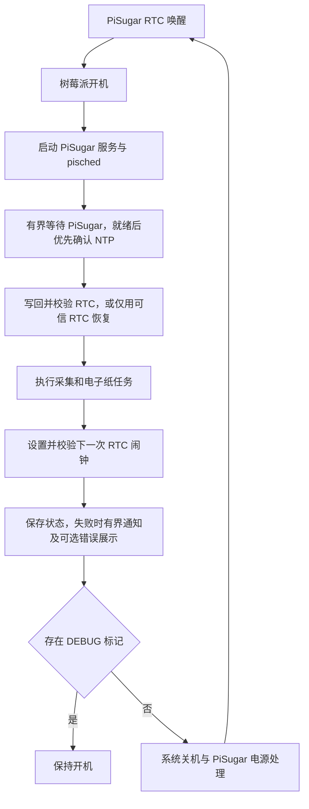

# 架构与部署关系

设备由 Pi Zero 2、PiSugar 3 和 IT8951 电子纸组成。2026 年 10 月 22 日设备运行 Debian 13.2 ARM64，屏幕日志报告 1872×1404、VCOM −1.56 V、显示模式 1。当前源码使用 `BCM` 后端，链接 bcm2835 1.60。

## 一次唤醒的流程

`pisched.service` 是 `Type=oneshot`，不是定时器。每次开机会立即执行任务，然后选择严格晚于当前时刻的下一个计划时间。服务执行完显示 `inactive (dead)` 是正常现象。DEBUG 保持开机后，下一次刷新需要手动触发或重新开机；RTC 闹钟不等同于操作系统中的周期任务。

任务执行结束后，调度器设置并校验下一次 RTC 闹钟。

电池运行的目标是所有路径在预算内结束并请求关机，包括闹钟设置失败；失败先记录，并通过预留接口做有次数和总时限的通知。DEBUG 为显式维护例外。统一收尾与通知接口已实现，systemd 对崩溃和总超时提供独立关机兜底；详见 [失败处理约定](failure-handling.md)。

## 文件映射

| 仓库文件 | 树莓派位置 | 说明 |
| --- | --- | --- |
| `src/scheduler/pisched.py` | `/opt/pisched/pisched.py` | 调度主程序 |
| `src/tasks/collect_metrics.py` | `/opt/pisched/collect_metrics.py` | 指标采集和刷新任务 |
| 选定的 `config/*.json` | `/etc/pisched/config.json` | 部署时明确选择 |
| `deploy/systemd/pisched.service` | `/etc/systemd/system/pisched.service` | 有限期限与失败关机兜底 |
| 构建的 `build/display/epd` | `/home/wlt/IT8951/epd` | 默认安装路径，可配置 display.path |
| `deploy/boot/config.pi-zero2.txt` | `/boot/firmware/config.txt` | Pi Zero 2 配置参考，不随发布包安装 |

PiSugar 服务由系统安装包管理：`pisugar-server.service` 提供 Unix socket；`pisugar-poweroff.service` 在关机流程中运行 `/usr/bin/pisugar-poweroff`。本项目的发布包仅安装应用文件，PiSugar 的 unit 和参数通过系统包管理。

## 数据流

采集程序从调度器环境读取已校验配置，独立读取电量、电压、温度、Wi-Fi 和 ping；单项失败记为缺失值，仍写 CSV 和刷新页面。socket、网络目标、接口和显示路径都来自同一份配置。CSV 使用 UTC 带偏移时间，指标原子保存到 metrics_file。日志及 CSV 在应用内按 1 MiB、4 份备份轮换。

电子纸程序通过 PISCHED_BATTERY 消费同一份电池样本；没有样本则显示 N/A。SNAPSHOT 为页面样本标签，不代表调度闭环成功。调度器将匹配本轮事件的指标、失败、通知和关机请求结果保存在 state_file，未来错误页面可通过 failure_display 接口读取。

日志位置：

- `/var/log/pisched/pisched.log`：调度步骤、任务结果、闹钟校验。
- `/var/log/pisched/epd.log`：电子纸程序输出。
- `journalctl -u pisched.service`：systemd 收集的标准输出。
- `journalctl -u pisugar-server.service`：PiSugar 服务日志。

## 显示程序

`singlepage/main.c` 固定 VCOM 为 1560 mV、模式为 1，初始化屏幕、清屏、调用 `SinglePage_Show()`、休眠并等待 5 秒后释放硬件资源。程序入口为 `main(void)`，运行时不需要命令行参数。

`singlepage/page.c` 使用 4 bit 灰度帧缓冲、内置字库和相对屏幕尺寸的布局，绘制设备信息、时间、电池和固定状态。中文字符串使用原厂字库对应的字节编码，增加中文内容时不能直接假定任意 UTF-8 文本都可显示。

Makefile 编译 `singlepage/` 和 `lib/` 中的驱动、绘图与字库代码，生成 `epd`。
