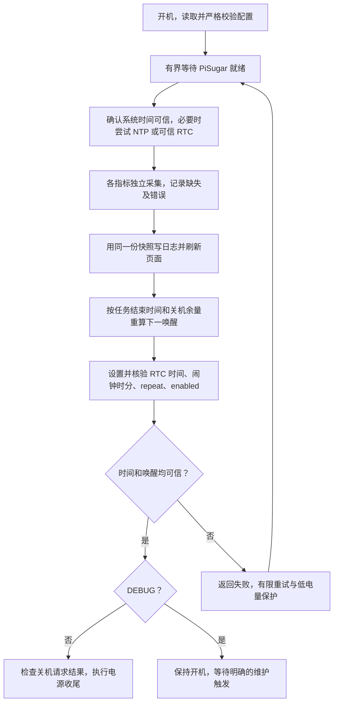

# 项目与 Pi 运行审查（2026-10-22）

## 结论和范围

“RTC 唤醒 → 开机执行一次 → 刷新电子纸 → 安排下次唤醒 → 关机”的方向适合低频、电池供电的电子纸项目，无需改成长期运行的循环。但当前实现尚不适合无人值守：实际 RTC/闹钟异常、任务超时失效、错误被报告为成功、断网阻断刷新，会使设备失去更新或唤醒能力。

本次检查以提交 `835057b` 的源码、2026-10-22 约 02:53–02:58 EDT 的 Pi 只读查询为依据。读取了调度器、任务、显示和驱动、配置、systemd、构建与维护脚本，重新编译 ARM64 显示程序，完成隔离异常复现。没有部署应用、修改设备配置、设置 RTC、校时、启动真实采集任务、重启或关机。

设备项目快照：`backups/device/20261022T065409Z/`，37 个文件，含 SHA-256 清单；该目录被 Git 忽略。隔离复现工具位于 `build/audit/`，同样不提交。以下区分设备实证、离线复现和代码推导；没有把编译成功当作屏幕或唤醒验证成功。

## 已核实的设备状态

| 项目 | 结果 |
| --- | --- |
| 系统 | Pi Zero 2，Debian 13.2 ARM64，内核 6.12.47+rpt-rpi-v8 |
| 时间 | America/New_York，查询时 NTP 已同步 |
| PiSugar | PiSugar 3，固件 v1.3.4，pisugar-server 2.3.2-1，服务 active |
| RTC | 两次读取为 `2020-01-21T20:37:04.000-05:00` 和 `20:37:06`；在走时，但日期错误 |
| 闹钟 | enabled=true，时分为 01:00，repeat=127；这不证明期望的新闹钟写入成功 |
| 调度服务 | enabled；oneshot 已执行完，Result=success；本次启动记录闹钟设置 I/O error |
| 实际配置 | 半小时测试表；`shutdown_even_if_alarm_set_failed=true`，与仓库模板 false 不同 |
| DEBUG | `/boot/firmware/DEBUG` 目录存在；阻止最后关机，不阻止前面的校时/RTC/采集 |
| 时间组件 | 没有 hwclock 可执行文件，没有 `/dev/rtc*` |
| 电源策略 | `auto_power_on=false`；`auto_rtc_sync` 未设置；低电量提前关机阈值为 0% |
| 查询时电池 | 100%，4.209 V，外部供电接入；不能据此推断纯电池续航 |
| 资源 | 根分区约 10% 使用，内存 available 约 273 MiB；`get_throttled=0x0` |
| 启动耗时 | 本次内核+用户空间约 96.2 秒；pisched 约 47.4 秒 |

仓库与设备上的调度器、Shell 任务完全一致。24 个显示 C/H 文件中，23 个在归一化换行后相同；`page.c` 仅页脚 `singlepage v1` / `PI STATUS` 不同。设备二进制与本次本地重编译产物哈希不同，未做二进制等价认证，也未部署覆盖。

## 需要优先处理的问题

### F1 · P1：真实闹钟写入失败，而设备配置允许失败后关机

**设备实证。** 本次启动 01:20:55 的日志：

```text
rtc_alarm_set 2026-10-22T01:30:00.000-04:00 127
-> rtc_alarm_set: I/O error: I/O error (os error 5)
Alarm set/verify FAILED
Debug mode enabled, skip shutdown
```

实际 `/etc/pisched/config.json` 仍将 `shutdown_even_if_alarm_set_failed` 设为 true。`src/scheduler/pisched.py:319` 在移除 DEBUG 后会执行关机，即使新闹钟设置失败。残留的 01:00 闹钟与期望的 01:30 不一致，不能作为唤醒保障。

应先保留 DEBUG，正式配置恢复为 false，再验证正确时间写入、闹钟写入与读回、关机断电和自动唤醒。当前不能断言硬件已损坏，也不能承诺只改 Python 就恢复 RTC 写入。

### F2 · P1：不验证 RTC 时间，就覆盖系统时间

**设备实证和代码确认。** `pisched.py:166–171` 的“健康检查”查询 RTC 后，无条件执行 `rtc_rtc2pi`。本次 journal 确认系统时间从 2026 年退回 2020-01-21，随后才由 NTP 纠正。`done` 只说明服务接受并执行了这条操作，不证明 RTC 时间可信。

若断网，程序会在错误年份下继续采集、显示和安排闹钟。即使 NTP 已经就绪，重新启动服务也会先用旧 RTC 覆盖系统时间。

应明确时间可信度：已经同步的系统时间优先；只有在系统时间不可信、RTC 值通过合理范围及历史检查时才恢复。RTC 不能证明可信且 NTP 失败时，进入有界恢复流程。

### F3 · P1：NTP 校时本身触发“超时”，跳过系统时间写回 RTC

**设备实证和离线复现。** `pisched.py:94–108` 用 `time.time()` 计算等待时长。本次日志的顺序是：

1. RTC 把系统时间改成 2020 年。
2. `NTPSynchronized=no` 连续出现。
3. timesyncd 在真实时间 01:20:29 完成 2026 年校时。
4. 调度器下一次循环先计算时间差，直接跳出，在 01:20:34 报“未在超时内同步”。
5. `pisched.py:272–279` 的 `rtc_pi2rtc` 分支没有执行。

隔离 mock 将系统时钟前跳后，函数只查询一次状态即返回 false，下一条已准备好的 `yes` 没有机会读取。这会形成“旧 RTC → 回拨系统 → NTP 前跳 → 误判超时 → RTC 仍旧”的循环。

所有等待期限改用 `time.monotonic()`；外部命令也要有超时；同步结束后检查最终状态。系统写回 RTC 后必须检查响应并读回误差，当前只是写日志，未检查非 done 响应。

### F4 · P1：任务超时与进程清理失效，硬件等待可卡住整个周期

**离线复现。** `pisched.py:200` 先阻塞于 `stdout.readline()`，之后才判断超时。本地设置 0.15 秒超时，无输出的 1.2 秒任务实际执行约 1.226 秒并返回 0；子进程继承 stdout 的案例约 0.852 秒才返回，仍为 0。

`proc.terminate()` 仅终止直接子进程，不能保证 Shell 下的 epd 被终止。底层 `EPD_IT8951.c:59–68` 的 busy 引脚轮询和 `:380–387` 的显示等待都没有超时；当前任务将 epd 输出重定向到文件，调度器管道尤其容易一直没有输出。Pi 上 `TimeoutStartUSec=infinity`，systemd 不会在启动超时后兜底。

应使用非阻塞输出读取或受控日志文件、单调时钟、独立进程组和 TERM→KILL→wait 清理；为驱动提供超时错误返回，并设置覆盖全周期的 systemd 最长执行时间。仅在 Shell 外面套 timeout 不足以修复全部路径。

### F5 · P1：任务执行前选闹钟，任务跨过时间点后会设置过期闹钟

**代码确认和纯计算复现。** `pisched.py:283–286` 在任务前计算 next_dt，`:298` 在任务后使用旧值。11:59:50 选中 12:00，任务 12:00:15 结束时仍设置 12:00；每天重复的硬件闹钟已经错过当天机会，而 16:00 本应是下次运行。

在任务结束后重新选择下一时点，并预留经过实测的关机余量。即使闹钟仍在未来，也不能让它在设备尚未完成关机时触发。任务启动异常也应进入统一收尾；目前 Popen 抛异常会直接跳过闹钟阶段。

### F6 · P1：普通采集失败会阻断 CSV 和电子纸刷新

**Linux 容器隔离复现。** `my_test_task.sh:18` 的 iwconfig/grep 管道和 `:25` 的 RTT 管道受 `set -euo pipefail` 影响。NaN 回退在后面，无法补救已经退出的脚本。

| 模拟情况 | 脚本返回码 | CSV | 进入显示程序 |
| --- | --- | --- | --- |
| 正常 | 0 | 写入 | 是 |
| Wi-Fi 接口/信号缺失 | 1 | 未写入 | 否 |
| ping 100% 丢包，无 RTT 行 | 1 | 未写入 | 否 |
| 显示程序返回 7 | 0 | 写入 | 是，错误被隐藏 |
| PiSugar 返回 `battery: I/O error...` | 0 | 写入 `I/O` 字符串 | 是 |

采集应分别校验字段与记录失败状态，缺值用明确的缺失标记；网络离线时仍应刷新可用的本地内容。PiSugar/nc 和 ping 应有明确的单项最长耗时。保持严格模式，但对预期的测量失败显式处理。

### F7 · P1：错误被多层吞掉，外部看起来始终成功

**设备实证、离线复现和代码确认。** 闹钟失败后 `pisched.py:325` 仍只返回任务 rc；设备本次因此显示 `status=0/SUCCESS`。Shell `:44` 的 `|| true` 隐藏 epd 返回码，二进制不存在的 else 分支也未返回失败；`pisched.py:321` 未检查关机命令返回值。

应分别记录采集、显示、RTC 同步、闹钟和关机结果，给关键失败返回非零状态；同时区分“显示内容降级但周期安全完成”和“无法保证下次唤醒”。页面两处 READY 是固定文字，不应作为真实成功证据。

### F8 · P2：PiSugar 启动依赖、重试和留机恢复流程缺失

**代码确认，启动日志显示存在早期 I2C 初始化失败。** `deploy/systemd/pisched.service:3–4` 仅等待网络，未明确依赖 PiSugar。Type=simple 的 PiSugar 服务已经 active，也不等于 socket 和 RTC 已经可用。调度器首次健康检查失败直接返回 10，没有重试；unit 也没有恢复安排。

在启动依赖之外增加有最长时限的 socket/协议就绪检查；关键阶段使用有限次数退避重试。DEBUG 或闹钟失败留下的开机状态需要独立的恢复触发机制。当前 oneshot 完成后不会再刷新，不能用“半小时表已配置”推断设备保持开机时也每半小时更新。

## 显示、配置和长期运行问题

### F9 · P2：4 bpp 白底填充错误，未重画的背景是黑白条纹

**离线帧缓冲复现。** `page.c:219–220` 选择 4 bpp 后调用 `Paint_Clear(PAGE_WHITE)`，而 PAGE_WHITE=0xF0。`GUI_Paint.c:292–295` 直接 memset 每字节为 F0；每字节的两个像素分别为白 F 和黑 0，而纯白应为 FF。

对实际 1872×1404 页面、ARM Linux 对应的 unsigned-char 语义进行离线渲染，在未被布局重画的留白位置读取到 0xF0，页面函数仍返回 0。应区分单像素颜色与压缩帧缓冲填充值，修正后检查整页灰度图。未声称本次已肉眼核验实体屏幕。

### F10 · P2：绘图库边界检查允许坐标等于宽高，造成越界

**AddressSanitizer 复现。** `GUI_Paint.c:178` 和 `:222` 使用 `>`；合法坐标的上限应为 width-1 / height-1。在 4×4 的 4 bpp、8 字节帧缓冲调用 `Paint_SetPixel(0,4,0)`，ASan 报 heap-buffer-overflow。

这是可达的绘图库缺陷，但本次实际尺寸的完整页面渲染没有触发 ASan 错误，不能将其报告成当前页面必然崩溃。应统一绘图入口的边界约定，并检查字形绘制抵达底边时的行为。清屏驱动 `EPD_IT8951.c:699–700` 另有 malloc 未判空的潜在失败路径。

### F11 · P2：部署前校验和实际运行校验是两套逻辑

**离线复现。** `scripts/project_config.py` 会拒绝空计划和非布尔值；实际运行的 `pisched.py:222–241` 不会。传入空 schedule 被接受，直到计算时才崩溃；字符串 `"false"` 被 `bool()` 变成 true，反转关机保护。repeat_mask 非 127 也能被直接装入运行配置，但 `compute_next_run()` 没有星期过滤。

应让实际运行和打包预览共用同一份严格校验，或在当前单文件部署中同步提供等效校验；不要只修维护工具。近期继续明确限制 daily=127，避免暗示已支持星期计划。

### F12 · P2：夏令时策略未定义，预览可以生成不存在的时间

**纯计算复现；硬件行为未验证。** 使用 America/New_York，2026-03-08 01:59 计算 02:30，得到 `02:30-05:00`，按时间戳往返后却是 `03:30-04:00`，说明原时刻不存在。秋季重复的 01:00/01:30 也未定义运行一次还是两次。实际调度器使用 naive datetime，预览却传入 ZoneInfo aware datetime，也应统一。

半小时测试表正好覆盖 DST 问题时段。应明确跳过不存在时刻、重复时刻只取一次或其他一致策略，并围绕未来时点的 UTC 偏移验证 RTC 读回。每日硬件闹钟只提供时分/重复语义；带日期的设置文本不能当作任意一次性日期闹钟。仓库白天示例避开了凌晨缺失时段，但跨时区偏移变化仍需完整唤醒测试。

### F13 · P2：保持开机的失败保护缺少电量和恢复边界

**设备实证和设计缺口。** PiSugar 当前低电量提前关机阈值 0%，调度器也没有有效电量下限判断。闹钟失败时留机是合理的可维护策略，但长期没有重试/告警/截止时间，纯电池运行可能最终耗尽并非正常关机。当前有外部供电，不能把这次在线状态当作续航测试。

需要独立的低电量保护和维护恢复策略，结合 DEBUG、外部供电、剩余电量确定行为；硬件欠压保护不能替代操作系统安全关机。阈值和策略应按电池实测决定。

### F14 · P2：电源控制接口监听所有 IPv4 网卡，UDS 对所有本地用户可写

**设备实证。** `ss -lnt` 显示 PiSugar 8421/8422/8423 均监听 `0.0.0.0`；UDS 权限为 `srw-rw-rw-`。项目运行只依赖 UDS。PiSugar 的命令协议包含校时、设置闹钟和控制电源，应限制能接入该接口的主体。

应根据实际 WebUI 使用需求收敛监听地址、防火墙与 socket 权限。本次未验证防火墙规则或互联网可达性，未读取/测试 Web 密码，也没有执行控制型命令；不能据监听地址断言可被互联网直接访问。

### F15 · P3：数据、部署一致性和功耗验证仍需补齐

- CSV、epd.log、pisched.log 仅追加，设备 `/etc/logrotate.d` 未发现项目规则；长期运行需轮换和保留期。
- 网络地址、接口、socket 和 epd 路径分散；显示程序重新读取电池，未消费同一份采集结果。宜形成一次带时间与质量状态的快照，再供 CSV 与页面使用。
- 只有 6 个维护测试，覆盖配置、打包和普通时间边界；没有覆盖上述真实异常路径。通过 make check 不等于调度闭环正常。
- 发布包没有自动校验设备实际已安装的所有文件与 release 清单；此次已发现配置漂移。部署需读回哈希、明确记录配置及版本。
- 本次重建成功，编译只有驱动未使用函数警告；APT 包仍未逐个固定。是否需要严格可复现构建，可按维护成本决定。
- 本次启动约 96.2 秒；关键链包含网络等待、cloud-init 等。先测量各阶段耗时与电流，再决定优化服务；不依据启动配置注释认定 USB/HDMI 已按预期省电。
- 每次清屏、整页重画、末尾额外 5 秒等待会增加开机时间。应测量刷新完成时刻再优化，保持 VCOM 与波形参数不变。

## 推荐流程

保留 oneshot 和 PiSugar 唤醒方式，将一次运行改成有截止时间、明确结果的状态流程：



图中的重试必须有次数与总期限，不能在故障下无限循环；执行异常也要进入统一结果记录及收尾。可以考虑任务前预设一个已验证的保底闹钟，再在任务后覆盖为最终计划，但它不能替代任务后的重算与关机余量校验。

现有拆分（调度/采集/显示）可以保留。优先消除错误传播和时间状态问题，再做配置统一；没有必要在这一阶段引入数据库、消息队列或复杂服务框架。

## 修复顺序与验收

1. **先保证可维护性。** 保留 DEBUG，修正待部署的失败关机策略；定位 RTC 写入错误。不要移除 DEBUG 来“试试看”。
2. **修调度闭环。** 可信时间、单调时钟、进程组超时、任务后重算、统一错误返回、服务就绪与有界恢复。
3. **修离线/显示路径。** 测量失败不阻断本地页面，显示失败可见；修复灰度背景和绘图边界；统一运行时配置校验。
4. **再做有人值守的硬件验收。** 分别验证 RTC 写入读回、期望闹钟读回、显示结果、关机断电、下一时点重新开机；至少覆盖连续多个周期及一次跨夜，并验证离线和任务失败。
5. **最后优化续航。** 确认 DEBUG 下的维护行为、低电量策略、日志轮换，测启动与刷新电流，选定正式日程后再启用无人值守。

## 本次验证记录和限制

- `make check`：6/6 通过，Python/Shell/配置/CSV/归档校验通过。
- `make preview CONFIG=config/daytime.example.json`：白天计划和跨夜输出正确。
- `docker compose run --rm --no-deps display-build`：Debian 13 ARM64 重编译成功，生成 Linux aarch64 ELF；没有执行该产物。
- Python 隔离探针：复现静默任务超时、继承管道延迟、运行配置布尔反转/空计划、任务跨点、DST 缺失时间；另以 mock 复现 NTP 前跳误判。
- Linux 容器 Shell 探针：5 种场景，只使用替代 nc/iwconfig/ping/epd/sync；路径全部改为容器临时目录。
- C 探针：对实际页面做无硬件渲染，验证白底字节错误；ASan/UBSan 验证边界像素越界，实际尺寸整页未触发内存错误。
- SSH：只读状态、日志、白名单文件与 PiSugar get 命令。没有做真实关机/自动唤醒验收，RTC 写入失败的具体硬件、固件或驱动根因仍待定位。

PiSugar 官方实现显示 PiSugar 3 经 0x57 MCU 接口操作 RTC；可选的 DS3231 兼容系统 RTC 是另一层接口。缺少 hwclock/系统 RTC 会使相应系统硬件时钟命令失败，但不能据此认定它就是当前 `rtc_alarm_set` I/O error 的原因。参考 [v2.3.2 PiSugar 3 源码](https://github.com/PiSugar/pisugar-power-manager-rs/blob/v2.3.2/pisugar-core/src/pisugar3.rs)、[官方 RTC 说明](https://docs.pisugar.com/docs/product-wiki/battery/pisugar3/pisugar-3-rtc)、[I2C 接口说明](https://docs.pisugar.com/docs/product-wiki/battery/pisugar3/pisugar-3-i2c)。本次没有据此增加 overlay、改寄存器或升级固件。
