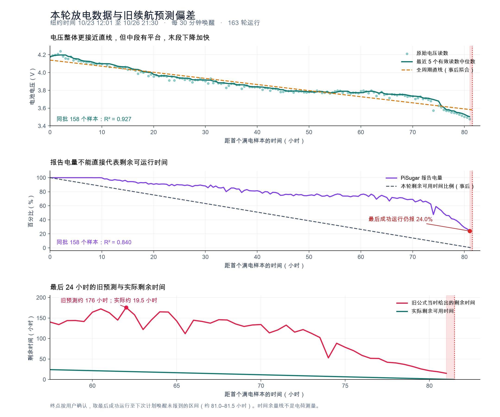

# 本机电池放电数据与续航估算设计

这次完整记录表明，PiSugar 当前的电量映射不适合直接推算这台设备的可用续航。电压随时间比百分比更接近线性，但仍有明显平台和末段加速。建议用本机完整放电建立电压参考曲线，以已运行时间和开机次数确定消耗进度，再用电压校正阶段，直接预测还能完成多少轮运行。

这是根据一轮完整运行记录提出的模型设计。数据和回放结果已冻结；本次分析未更改服务端算法或设备配置。

## 本轮记录和终点

以下时间均为 `America/New_York`，日期为 2026 年。用户确认本轮始终依靠电池供电，并确认最后无法自动开机时已没电，因此将本轮终点定义为可用供电终点。

| 项目 | 记录 |
| --- | --- |
| 首个满电样本 | 10 月 23 日 12:01，100%，4.178401 V |
| 最后成功样本 | 10 月 26 日 21:01，24.036125%，3.4774 V |
| 最后一次报告到达 | 10 月 26 日 21:01:19 |
| 下次计划唤醒 | 10 月 26 日 21:30，之后无新报告 |
| 从首个样本起算的可用时长 | 约 81.0 至 81.5 小时，即约 3.4 天 |
| 运行频率 | 每 30 分钟一轮，48 轮每天 |
| 记录数量 | 163 轮，161 个有效电量值，159 个有效电压值 |
| 公平比较两种曲线的配对样本 | 158 个，同时有电量和电压 |
| 唤醒安排 | 163 轮均记录下一次闹钟已确认，无遗漏的半小时运行周期 |

这里的终点是最后成功运行到首次计划唤醒未报到的时间区间，不是实测电荷为零的瞬间。3.4774 V 是最后成功时的采样电压，不能当作已测出的电池物理截止电压。

163 轮调度器执行时间合计约 1.98 小时，每轮约 42 秒；各日中位数接近，未观察到后段任务时长大幅增加。这些时长不包含完整开机和断电过程，不能直接据此计算真实能量或待机功耗。

## 电压和百分比的实际差异

对相同的 158 个配对样本分别做时间与读数的一元线性拟合：

| 指标 | 电压 | PiSugar 百分比 |
| --- | --- | --- |
| 直线拟合 R² | 0.927 | 0.840 |
| 拟合残差均方根 | 0.0449 V | 6.47 个百分点 |

两种残差单位不同，不直接比较其绝对大小。R² 仅描述本轮曲线与一条直线的接近程度，不是预测准确率。

PiSugar 3 的 `level()` 使用平均电压和配置的电池曲线换算百分比，并非独立的电量传感器。参见 [v2.3.2 官方实现](https://github.com/PiSugar/pisugar-power-manager-rs/blob/v2.3.2/pisugar-core/src/pisugar3.rs#L494-L501)。本轮实际接近运行终点时仍报告 24%，说明该读数与本机在当前负载下的可用续航明显不匹配；不能继续把它等同于剩余可运行时间的比例。

电压也不是全程恒速下降：0 至 24 小时的拟合斜率约为 −11.6 mV/小时，48 至 60 小时约为 −0.73 mV/小时，72 小时之后约为 −24.8 mV/小时。3.77 至 3.79 V 在 22 个读数中反复出现，前后跨度约 19.5 小时。单个电压值不足以确定精确剩余时长，需要结合已经运行到哪一阶段。



图中的时间余量线是按本轮最终可用时长回看计算的比例，不是电荷测量；全周期直线同样是事后拟合。

## 旧公式为什么失准

当前续航公式仍然使用：

```text
日耗电 = 本段首末电量净下降 / 已经过天数
剩余天数 = (最新电量 − 10%) / 日耗电
```

前两次修改改善了回弹误判和显示，但这条公式把前段缓慢的百分比下降速度外推到了末段，也假定了显示 10% 之前仍可正常开机。完整放电记录已经否定了这两项假定。

逐轮回放时只向旧模型提供当时已经收到的报告，预测中未读取未来样本。实际剩余时间在事后按首次缺失的计划唤醒计算，终点区间约有半小时分辨率。

| 采样时间 | 电压 | PiSugar 电量 | 旧公式剩余时间 | 到首次缺失唤醒的实际剩余时间 |
| --- | --- | --- | --- | --- |
| 10 月 25 日 20:01 | 3.794 V | 76.2% | 156.0 小时 | 25.5 小时 |
| 10 月 26 日 02:01 | 3.796 V | 76.5% | 175.7 小时 | 19.5 小时 |
| 10 月 26 日 12:01 | 3.704 V | 65.4% | 115.5 小时 | 9.5 小时 |
| 10 月 26 日 18:01 | 3.548 V | 40.7% | 40.4 小时 | 3.5 小时 |
| 10 月 26 日 21:01 | 3.477 V | 24.0% | 15.0 小时 | 约 0.5 小时 |

02:01 的预测约为实际剩余时间的 9 倍。只调整充电判断或把曲线显示出来，不能解决这种外推偏差。

## 建议的第一版模型

### 用本机完整周期建立电压参考曲线

将本轮作为首个标定周期，保存从满电到可用供电终点的时间、累计轮次、电压、温度和执行时长。按短时区间取电压中位数，再用单调分段拟合建立 `V_ref(a)`；`a` 表示在当前已标定使用方式下的等效运行进度，单位可取小时或累计轮次。保留平台和末段加速，不把所有区间压成同一条斜率。

这轮可先标定的只有“同一块电池、每半小时唤醒、相近任务负载”的约 81 至 81.5 小时可用时长，以及 163 轮已报到运行。不能仅凭这组固定频率数据推算改成每天几次后的续航，也不能把轮次均摊比例称为实测电池容量。

### 用运行进度消除平台区的歧义

在相同使用方式下，时间和累计轮次先给出进度预测，再用滤波后的电压在参考曲线中校正位置：

```text
预测进度 = 上次进度 + 本轮经过时间
电压可能对应的进度区间 = 参考曲线中与当前电压及噪声范围一致的区间
校正进度 = 在该区间内，优先保持与预测进度连续的位置
剩余可用时间 = 本机标定终点 − 校正进度 − 预留时间
```

平台区的一个电压可能对应很长时间范围，此时更多依靠已经运行的时间和轮次，不因电压短时回升就把进度拨回、清空历史或再显示还能用很多天。末段电压变化较明显时，提高电压对进度校正的作用。孤立异常读数不应直接把进度跳到另一阶段。

只有一轮参考数据时，像“运行到 62 小时后，参考周期只剩约 19 小时”属于下轮可用的初始标定，不能将它在同一轮上的精确对应当作已验证的预测效果。

### 把预测终点改为还能完成下一轮运行

页面主指标应为“按当前计划预计还能完成多少轮、约多少小时、建议何时充电”，PiSugar 的原始百分比作为诊断值保留。预测预留应覆盖下次启动和任务所需供电，不等待显示电量降至 10%。

本轮持续进入以下电压区间后，到首次未报到唤醒的时间为：

| 本轮观察到的持续低压阶段 | 最早进入时间 | 之后可用时间 | 可作为初始设计依据 |
| --- | --- | --- | --- |
| 不再回到 3.60 V 以上 | 10 月 26 日 16:01 | 约 5.5 小时 | 提前充电提示候选 |
| 不再回到 3.55 V 以上 | 10 月 26 日 18:01 | 约 3.5 小时 | 紧急提示候选 |
| 不再回到 3.50 V 以上 | 10 月 26 日 20:31 | 约 1 小时 | 已接近无法继续唤醒 |

这些是本机本轮的候选预警依据，不是通用电池安全阈值，也未据此更改 PiSugar 的硬件保护。14:01 曾有一次 3.574 V 读数，之后又恢复到 3.628 V，说明单点读数需要结合连续性；但低压告警应快进入、慢退出，不能被长时间平滑掩盖。最后五个有效电压的中位数约为 3.503 V，若只等该中位数低于 3.50 V，本轮在停止报到之前甚至不会触发。

## 后续采样和验证

保持采样阶段一致，并增加开机后的电压、刷新前后电压及本轮最低电压，避免把不同负载阶段混在一起。记录插电状态和充电状态，以真实供电状态识别周期变化；PiSugar 3 已提供相关读取，见 [官方实现](https://github.com/PiSugar/pisugar-power-manager-rs/blob/v2.3.2/pisugar-core/src/pisugar3.rs#L518-L542)。部分充电不能直接重置为一个完整的满电周期。

长期模型可以区分关机经过时间、开机轮次与累计开机秒数的消耗，但本轮每 30 分钟一次，时间与轮次高度相关，不能单独拟合出待机消耗和每次刷新的消耗。取得不同频率的完整周期后，再识别这些系数，按未来唤醒计划换算剩余时长。

下一轮完整放电应作为独立验证：固定本轮标定曲线后，逐次记录预测与最终结果，检查剩余时间的误差、过度乐观的最大误差，以及充电提示是否留出了预定余量。不随机拆分本轮相邻样本来宣称模型已经准确。先标明只有一轮标定，不给出未经验证的窄置信区间。

设备错过计划报到后，应立即标注预测更新时间和离线状态；不能在多个唤醒周期未报到后仍把旧电压当作实时依据。新的自动学习周期还需要明确结束原因，避免把网络或闹钟故障自动标成电池耗尽；本轮采用用户已经确认的耗尽结论。

## 数据和复核

- [冻结的逐轮 CSV](../data/samples/battery-discharge-2026-10-23-26.csv) 保留 163 轮顺序及原始数值，空值留空，并区分指标采样电量和启动检查电量。
- [分析元数据](../data/samples/battery-discharge-2026-10-23-26.json) 保存数据校验值、终点定义、同批样本拟合结果和旧模型回放检查点。
- 本地原始导出与逐轮回放结果保存在被 Git 忽略的 `data/runtime/proofs/battery-discharge-20261027/`。
- 校验覆盖行数、有效值数量、时间顺序、半小时周期连续性、闹钟确认、CSV SHA-256 和逐轮回放；曲线已检查排版。本次仅增加分析资料，服务和树莓派保持原实现。
