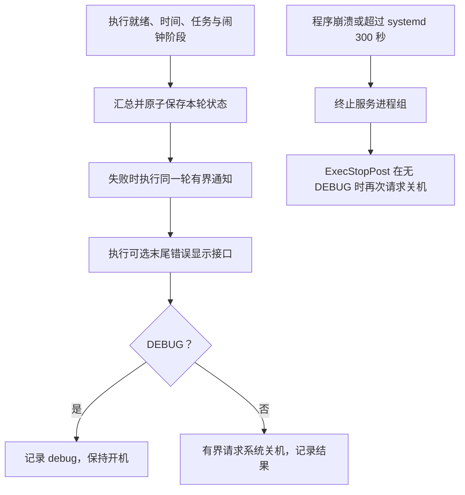

# 电池运行的失败处理

正常运行在预算内完成本轮并请求系统安全关机。采集、显示、校时、闹钟、通知失败均进入统一收尾；`shutdown_even_if_alarm_set_failed=true` 是预期配置。DEBUG 是有人值守维护的显式留机例外。

## 已实现的流程

`runtime.max_seconds` 默认为 240 秒，工作阶段提前为收尾预留时间。通知、退避、错误显示和关机共用剩余预算；临界预算不足则跳过可选动作，不能为新的失败重置预算。低电量时跳过采集、通知重试和错误显示。配置损坏、任务启动失败和磁盘写入失败也不能跳过关机。

进程执行使用独立进程组和文件输出，避免 stdout 无输出或被后代继承而阻塞。超时后 TERM、KILL 并等待直接子进程；systemd 的 KillMode=control-group 与独立期限兜底。失败退出码仍为非零，不以“已请求关机”掩盖原故障；没有无限服务重启。

## 通知接口

`notification.command` 是可选的可执行参数数组，默认 `[]`。本项目没有默认外部消息服务和凭据，也不会在未配置时发送消息。命令从标准输入读取本轮 JSON 状态；参数不经 Shell 拼接，命令输出不写入通知日志以避免带出凭据。

默认最多 3 次、单次 5 秒、总共 20 秒（含退避与清理）。第一次和后续重试使用相同 event_id，供接收端去重。非零退出、启动异常和超时算失败；0 表示通知通道接受，不能据此宣称用户已读。通知失败只更新本地 notification 结果，不再次触发通知。

未配置通道明确记为 `not_configured`；其他状态包括 `not_needed`、`accepted`、`failed`、`budget_exhausted`。低电量不执行通知调用。次数和总期限任一耗尽后仍关机。

## 持久化状态与未来 UI

`state_file` 原子保存事件 ID、设备、时间及其可信度、失败阶段/原因、可用电量、期望唤醒及校验结果、通知尝试次数和结果、关机请求结果，以及匹配本轮事件的指标样本。状态写入经 fsync 和同目录原子替换；失败仍继续通知与关机。后一轮成功会标记 recovered，并保留最近的 last_failure。

`failure_display.command` 是末尾错误展示的可选接口，同样从标准输入读取状态，默认空数组；UI 尚未设计。该入口位于闹钟和通知之后，可展示“下次唤醒未确认”“通知失败”等结果；命令失败、显示超时或预算不足不阻止关机。正常页面的 SNAPSHOT 只表示样本页面，不是整条链路成功。

## 验证与边界

离线测试替换硬件、任务、RTC 和关机调用，覆盖通知成功/重试/耗尽、时间预算、后代进程、启动失败、存储失败、显示失败、低电量和恢复状态；不执行调度器 main()。systemd 兜底、屏幕显示与完整断电唤醒需单独实机核验。硬件或内核无响应时，软件发出关机请求不等于已实际断电。
