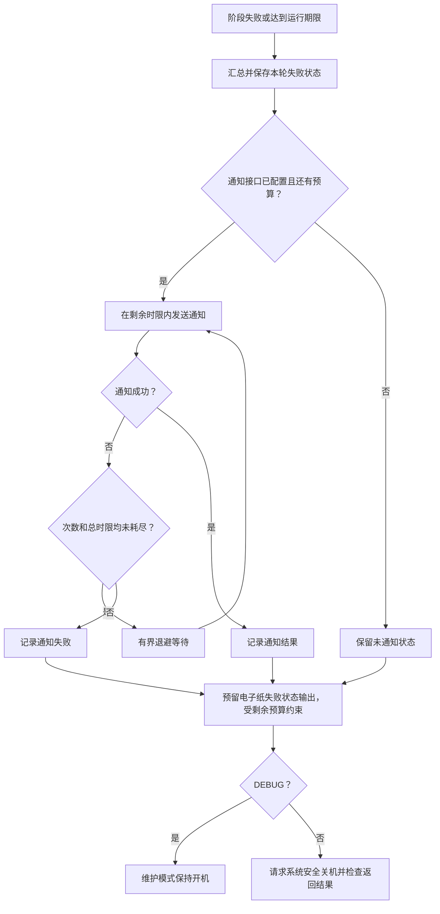

# 电池运行的失败处理约定

## 已确定的策略

设备将由电池供电。正常运行应在限定时间内完成本轮并请求系统安全关机；采集、显示、校时、闹钟或通知失败，都不能使设备无限保持开机。`shutdown_even_if_alarm_set_failed=true` 是这一目标下的预期配置。闹钟失败仍然意味着下次自动唤醒无法保证，这一结果需要明确保存和通知。

DEBUG 是有人值守维护时显式选择的留机例外。当前 Pi 上已有 DEBUG，本次没有移除，也没有修改设备。电池运行前应确认维护标记和故障收尾行为。

## 实现范围

本次已更新配置模板、审查结论与维护约定。以下通知接口、重试控制、统一失败状态和电子纸接入属于后续实现设计，尚未加入运行代码和可执行配置。

现有 `true` 配置只允许程序走到最后关机分支时忽略闹钟失败；它不能处理早期健康检查退出、异常崩溃或阻塞任务。后续必须把这些路径纳入统一收尾和整个运行周期的最长时限。

## 一次失败的收尾

所有失败共用本轮通知预算，避免每个阶段重新开始一组重试。没有剩余预算时直接收尾；低电量也可以缩短或跳过重试。关机请求本身失败应被记录，并纳入有界兜底策略，不能仅吞掉返回码或重新运行完整采集周期。

## 预留的通知接口

后续先提供可选的外部通知命令接口，具体使用哪一种消息服务另行选择。命令使用参数数组启动，结构化事件通过标准输入传入；不拼接 Shell 命令，也不把认证内容写入日志。未配置通道时明确记为未发送，不能报告通知成功。

事件至少包含：稳定的事件 ID、设备标识、时间及时间可信度、失败阶段和错误码、失败摘要、可用的电量、期望的下次唤醒及其是否已确认。同一次重试沿用事件 ID，供通知接收端去重；日志与未来页面消费同一份状态。

通知调用成功退出可作为该接口的成功信号；通知程序应根据所接服务的响应决定退出码。若服务没有送达确认，日志只说明通道接受，不能宣称用户已收到消息。

重试控制需要同时具备：

- 最大尝试次数，包含第一次发送。
- 整个通知阶段的总时限，包含调用、等待、退避与清理。
- 每次调用的超时，最多为当前剩余通知预算和本轮运行预算允许的时间。
- 有上限的退避等待，且只能在还有下一次尝试预算时等待。
- 超时后终止整个通知进程组并回收资源，不遗留继续运行的子进程。

可以从“最多 3 次、通知阶段最多 20 秒、单次最多 5 秒、两次等待分别 1 秒和 2 秒”开始实现与测量；这些是设计起点，尚未加入可执行配置。所有期限使用单调时钟。整个运行周期还应有独立于通知阶段的总时限和关机收尾余量，不能因重试重置。

通知异常只更新本地通知结果，不再次触发一轮“通知失败的通知”。未发送或发送失败的事件可保留到下次启动处理，但仍受下一轮共享预算约束。

## 失败状态与未来电子纸 UI

后续将最近一次失败原子保存到持久化状态文件，包含原始失败、通知结果及尝试次数。新的成功运行应明确更新恢复状态，保留上次失败发生时间，避免无限展示过期故障。

电子纸 UI 以后再设计，本次只确定它可以读取上述状态，表示“本轮失败”“通知未成功”“下次唤醒未确认”等信息。闹钟设置发生在正常页面刷新之后，因此需要预留末尾状态展示入口；展示尝试必须有独立上限并受本轮剩余预算约束。屏幕自身故障或预算不足时跳过展示，仍进入关机收尾。

## 后续验收

离线验证应覆盖通知未配置、首次成功、失败后成功、次数耗尽、总时限耗尽、通知子进程挂起、多个阶段共享预算、状态文件写入失败、显示失败和低电量提前收尾。正常模式下这些路径最终都应尝试关机；DEBUG 则应明确记录跳过关机。

硬件验证还需区分正常关机、PiSugar 实际断电和下一次成功唤醒。失败后关机是电池策略，不代表 RTC/唤醒故障已经修复。
